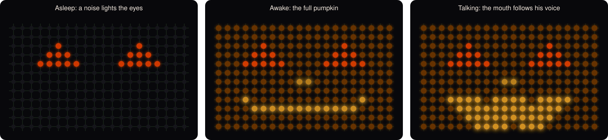

# Jim-o-Lantern 🎃

Jim the Jim-o'-lantern is a grumpy, roasting, talking pumpkin for your driveway on Halloween. He
sleeps in the dark until he hears someone, glares with glowing red eyes, then bursts to life with
a scary blood-red strobe and a growl, insults your costume, and holds a real conversation with
trick-or-treaters, with a mouth that moves along with his voice. (And he is *not* a
jack-o'-lantern. Don't call him Jack.)



Listen to him: [`samples/jim_demo.wav`](samples/jim_demo.wav)

Everything runs locally on one PC with an NVIDIA GPU. No cloud services are needed. Speech
(Jim's voice and his hearing) comes from the machine's shared
[Agentora speech service](#speech-agentoras-shared-service), which takes turns on the GPU with
the other AI tools.

## How it works

```
WLED mic ──UDP──▶ voice detection ─▶ Whisper (speech service) ─▶ Ollama LLM (Jim's personality)
                                                                        │
WLED LED curtain ◀──UDP── face animation + lip sync ◀── Qwen3-TTS (speech service) ◀┘
```

- **Face:** a 20×12 LED matrix (a WLED "curtain") shows a carved pumpkin face, driven with
  WLED's realtime UDP protocol. When nobody is around it's dark. The first noise lights only the
  eyes; a second noise sets off the wake-up animation, after which the whole face glows and the
  mouth follows the audio.
- **Ears:** the WLED controller's own PDM microphone, streamed to the PC by a small
  [firmware patch](#firmware-patch). A USB mic on the PC also works (`--mic default`).
- **Brain:** a local Ollama model (`qwen3.5:9b` by default) playing Jim, a furious, over-dramatic
  pumpkin who roasts costumes and tells terrible dad jokes. The Claude API is optional
  (`--brain claude`).
- **Voice:** Qwen3-TTS voice design (the voice is described in words), from Agentora's shared
  speech service. Replies are spoken sentence by sentence, so Jim starts talking about one second
  after a kid stops. Chatterbox and Kokoro are alternatives.

### Speech: Agentora's shared service

Jim doesn't load his own speech models any more. He uses the machine's shared Agentora speech
service (`agentora-speech`, `http://127.0.0.1:7895`, OpenAI-compatible):

- **Voice:** `POST /v1/audio/speech` with Jim's voice description as `instructions`. It's the
  same model and seed as before (`Qwen3-TTS-12Hz-1.7B-VoiceDesign`, seed 1234), so he sounds
  the same; the gentle voice is just another description.
- **Hearing:** `POST /v1/audio/transcriptions` (faster-whisper `small.en`). Each phrase goes up
  as a 16 kHz WAV.
- **Sharing the GPU:** the service loads both models under GPU-broker leases (`speech` ~5.5 GB,
  `speech-ears` ~1.2 GB), so they take turns with the radio, Hermes and ComfyUI. It unloads them
  after 2 idle minutes.
- **Warm-ups:** Jim sends a tiny warm-up request at startup and whenever the first noise lights
  his eyes, so the voice (about 8 s to reload) is ready by the time he talks.
- **Fallback:** if the service can't be reached, Jim says so in his log and loads his own copies
  (the local Qwen3-TTS server in `.venv-qwentts`, and Whisper in-process), so he keeps working.
  `--local-whisper` forces in-process Whisper.

### Kid safety

Roasts stick to costume choices and candy taste. A **code-level safety switch** watches what kids
say: if a child sounds scared or upset ("I'm scared", crying, "I want to go home", "you're
mean"…), Jim drops the act for the rest of that conversation, with a gentle prompt *and* a softer
voice, no matter what the model would have done. Jim never asks for personal details.

## Hardware

What I used:

- **LED curtain:** [Govee Outdoor Net Lights, 240 LEDs, 2.8 × 4.7 ft (RGBIC)](https://www.amazon.com/dp/B0D73H4PJJ).
  The 240 LEDs form Jim's 20 × 12 face. They're driven by the WLED controller below instead of
  Govee's own controller.
- **Controller:** [ESP32 WLED LED Strip Controller, 4 channel outputs, 15 A fuse](https://www.amazon.com/dp/B0F8NRG27V),
  running WLED with AudioReactive and a PDM microphone. Its other outputs drive three extra
  30-LED strips that glow along with Jim's voice.
- **PC:** an NVIDIA GPU (tested on an RTX 4090). Jim's chat model takes about 6.7 GB; the shared
  speech service adds about 6.7 GB while it's loaded.
- **Speaker:** anything the PC can play through, placed near the pumpkin.

## Setup

1. Install [uv](https://docs.astral.sh/uv/), [Ollama](https://ollama.com) and `alsa-utils`, then
   pull the chat model:
   ```bash
   ollama pull qwen3.5:9b
   ```
2. Create the environments and download the models:
   ```bash
   ./setup.sh
   ```
   Jim expects Agentora's speech service on `http://127.0.0.1:7895` (`systemctl --user status
   agentora-speech`). Without it, he falls back to the local copies `setup.sh` installs.
3. Flash the [firmware patch](#firmware-patch) to your WLED controller (or use `--mic default`).
4. Copy the settings file and put in your WLED controller's address (and your mic, speaker and
   camera if you use them). `jim.toml` isn't committed, so your addresses stay private:
   ```bash
   cp jim.example.toml jim.toml
   ```
5. Start Jim:
   ```bash
   ./start.sh
   ```

## Control panel

```bash
./panel.sh
```

Then open **http://127.0.0.1:8790** on the same PC. The panel runs Jim for you (Start / Stop / Restart / Snooze;
stopping the panel stops Jim) and has tabs for:

- **Live:** the camera, the exact frame Jim last judged and the vision model's verdict, a hearing meter (how loud
  the mic is vs. what Jim reacts to), a log of wake-ups and replies, and Jim's console.
- **Camera:** the security camera's IP, user, stream path and password (saved like `./set_camera.sh`: the
  password only in `~/.config/jim/rtsp`), or a USB webcam; a Test button grabs a picture.
- **Mic:** pick the microphone, record 3 seconds to see the background noise and get a suggested minimum loudness.
- **Voice:** the voice descriptions (normal and gentle), pitch, intonation, echo and grit, with a Preview that
  plays in the browser.
- **Replies:** house rules, creativity (temperature), reply length, the chat model, timing and the LED face.
- **Recordings:** turn recording on, and play back each visit: the frames, what the kids said (as heard) and Jim's
  replies (as played). Recordings hold children's voices and pictures: they stay in `recordings/` (never
  committed) and are deleted after `record_keep_days` (7 by default).

**More than one Jim:** press **＋ Jim** in the panel's header to add another pumpkin with his own LED controller.
Each Jim has his own settings file (`jim.toml` for the first, `jims/<id>.toml` for the others), camera, mic, speaker,
recordings folder and metrics; the header shows each one's state, and every tab shows the selected Jim. Saved cameras,
mics and speakers are shared, but a USB mic, webcam or speaker can only serve one Jim at a time (the panel warns).
They share one loaded copy of the chat model.

Camera, mic and speaker changes apply while Jim runs; voice and personality changes need a restart.
Settings are saved to the selected Jim's file (your comments are kept). The panel itself answers only on
this PC. To keep it running in the background, install `systemd/jim-panel.service` as a user service. On jt's machine,
Agentora's sign-in gate (`jim-gate`, Studio admins only) and Tailscale relay make it reachable from other devices at
`https://<machine>.<tailnet>.ts.net:7885/`.

## Using Jim

| Command | What it does |
|---|---|
| `./start.sh` | Start Jim: dark, waiting for noises |
| `./start.sh --start-delay 30` | Start asleep for 30 s, giving you time to leave |
| Press **Enter** in Jim's terminal | Snooze: dark and deaf for 10 s (`--snooze` changes it) |
| `./start.sh --levels` | Show live mic levels, for tuning `--vad-ratio` / `--min-rms` |
| `./start.sh --type` | Type to Jim instead of talking (testing) |
| `./start.sh --face-only` | Cycle through the LED animations |
| `./start.sh --house "Two pieces of candy each!"` | Tell Jim about your house rules |
| `./start.sh --voice-design "..."` | Describe a different voice |
| `./start.sh --tts chatterbox` / `--tts kokoro` | Use a different voice engine (these run locally) |
| `./start.sh --speech-url http://host:7895` | Use a speech service somewhere else |
| `./start.sh --local-whisper` | Run Whisper in Jim's own process instead of the speech service |
| `./start.sh --watch-port 8780` | Watch what Jim sees and decides at http://127.0.0.1:8780: the live camera, the frame he last judged with the verdict, and a log |
| `./start.sh --keep-loaded` | Keep the voice, ears and chat model warm while Jim runs |
| `./start.sh --max-words 15` / `--silence 2` | Shorter replies / wait longer for kids to finish |
| `./start.sh --ollama-model qwen3.6:27b` | Smarter chat model (needs about 11 GB more video memory) |
| `./start.sh --brain claude` | Use the Claude API instead of Ollama (asks for an API key) |

**Settings:** `jim.toml` holds this machine's settings: the WLED address, mic, speaker,
service URLs and camera. Any option above can go there with underscores instead of dashes
(`--min-rms 800` becomes `min_rms = 800`); options on the command line still win.
`jim.example.toml` lists them. The camera password is never stored there: `./set_camera.sh`
asks for it, using the camera's `ip` and `user` from `jim.toml`, and saves the full address to
`~/.config/jim/rtsp`, readable only by you.

The 12 greetings are recorded once and saved in `cache/`, so restarts are quick.

**Jim only runs while you run him.** Nothing starts him automatically, and when he stops (Ctrl+C,
closing the terminal, or a kill) he unloads his chat model from Ollama right away. The speech
service drops the voice and ears on its own about 2 minutes later.

Run `./run.sh --help` for every option. Jim's personality, greetings and goodbyes are at the top
of [`pumpkin.py`](pumpkin.py) (`SYSTEM_PROMPT`, `GREETINGS`, `GOODBYES`).

## Firmware patch

Stock WLED's AudioReactive usermod only shares volume and frequency bands, and it stops reading
the mic entirely while realtime LED data is coming in. [`firmware/micstream.patch`](firmware/micstream.patch)
(against WLED `v16.0.1`, ~80 lines in `usermods/audioreactive/audio_reactive.cpp`) adds raw
mic streaming:

- A client sends `PMIC` (plus an optional gain byte) to UDP port 21330 about once a second.
- While those keep arriving, the controller streams `PMA1 | seq | rate | count | int16[count]`
  packets back (22,050 Hz mono), even while the LEDs are in realtime mode.

`firmware/WLED_16.0.1_ESP32_pumpkin-mic.bin` is a prebuilt image for the classic ESP32
`esp32dev` build. You can upload it in WLED under *Config → Security & Updates → Manual OTA*.
To build it yourself:

```bash
git clone --branch v16.0.1 https://github.com/wled/WLED.git firmware/WLED
cd firmware/WLED && git apply ../micstream.patch && npm ci && pio run -e esp32dev
```

WLED is licensed under the EUPL-1.2, and the patch and prebuilt image are derived from it.

## Files

| File | Purpose |
|---|---|
| `pumpkin.py` | Jim: LEDs, mic, wake-up logic, speech recognition, personality, voice playback |
| `jim_panel.py` / `panel.html` / `panel.sh` | The control panel (http://127.0.0.1:8790) |
| `tts_server.py` | Local TTS server for Chatterbox, and the Qwen3-TTS fallback when the speech service is down |
| `start.sh` / `run.sh` | Launchers |
| `setup.sh` | Creates the Python environments and downloads models |
| `voices/jack_reference.wav` | Reference voice for the Chatterbox engine (generated, not a real person) |
| `firmware/` | WLED mic-streaming patch and prebuilt firmware |
| `docs/jim-curtain.svg` | The image above, rendered from Jim's real face-animation code |
