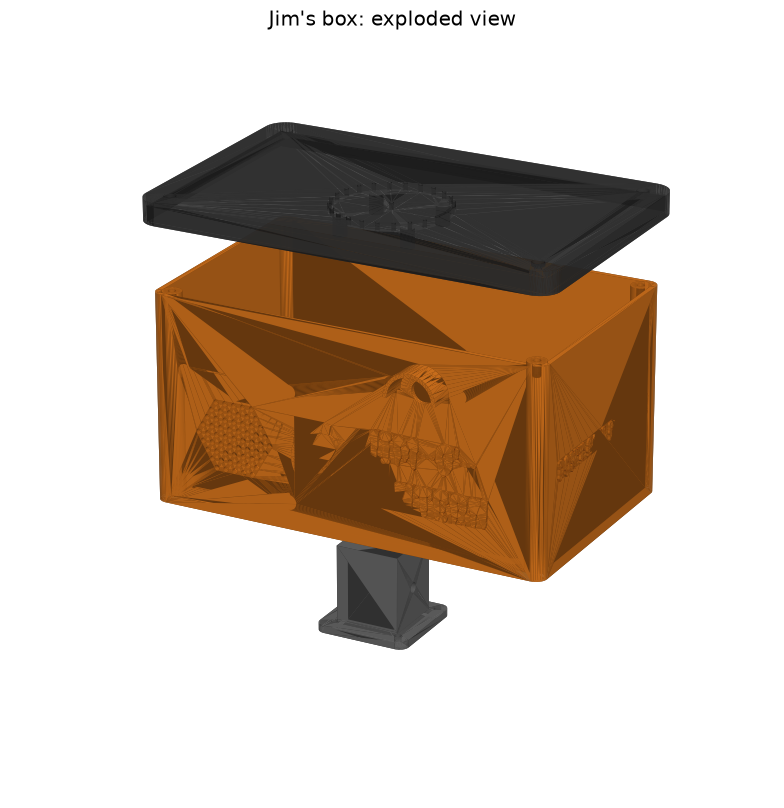

# Jim's all-in-one outdoor box

One weather-resistant box on top of a 1 × 1 inch post that holds everything at the pumpkin.
The PC stays indoors and does the thinking over Wi-Fi.



| Printed part | Size (mm) | Print orientation |
|---|---|---|
| `body` | 215 × 144 × 110 | Upright on its floor. Tree supports only under the camera hood |
| `lid` | 224 × 140 × 14 | Upside down (top surface on the bed) |
| `speaker_cup` | 70 × 70 × 42 | Flange down |
| `camera_mount` | 46 × 30 × 6 | Flat |
| `post_socket` | 50 × 50 × 45 | Flange down |

The body carries a raised **Jim-o'-Lantern** graphic: a carved pumpkin and his name on the front,
and "Don't call me Jack!" on the right side. The font is
[Creepster](fonts/OFL.txt) (SIL Open Font License).


**Two colours (AMS):** instead of `body`, load `body_plain` and `logo` together as one object
(Bambu Studio asks *"Load as a single object with multiple parts?"*: choose **Yes**). Then set the
logo to black and the body to orange. The pumpkin's carved eyes and grin show orange through.
Single colour: print `body`, which already has the graphic.

STL and STEP files are in [`out/`](out). To change any size, edit the numbers at the top of
[`jim_case.py`](jim_case.py), then run `../.venv-cad/bin/python jim_case.py` (and `render.py` for
fresh previews). See `../setup.sh` for the environments.

**Print settings (Bambu X1C):** ASA (best outdoors) or PETG, 0.2 mm layers, 4 walls, 25%
gyroid infill. Don't use PLA: it softens in sun and heat.

## Measure before printing

These are placeholders in `jim_case.py` (marked `MEASURE`):

- **WLED controller:** board size and mounting-hole positions (`CTRL_W`, `CTRL_D`, `CTRL_HOLES`).
- **Speaker:** cone or grille diameter, frame size, depth (`SPK_CUTOUT`, `SPK_FRAME`, `SPK_DEPTH`).
- **Mic array:** board diameter and mounting-hole radius (`MIC_D`, `MIC_HOLES_R`).
- **Amp HAT:** the total height of the Pi + HAT stack, with its speaker terminals and wires.
  The box has about 100 mm of headroom, so this is a sanity check.

## Parts

| Have | Part |
|---|---|
| ✅ | WLED ESP32 controller (drives the 5 V LED net and strips) |
| ✅ | Raspberry Pi 3B + amp HAT |
| ✅ | 5 V LED net (240 LEDs) + 3 × 30-LED strips |
| ⬜ | Mic: ReSpeaker XVF3800 USB 4-mic array (USB to the Pi) |
| ⬜ | Speaker: 2" (50 mm) full-range driver, 4 Ω, 3–5 W (match your amp HAT) |
| ⬜ | Camera (optional): Raspberry Pi Camera Module 3, standard. A 300 mm 15-pin ribbon cable gives slack |
| ⬜ | Power: 5 V 10 A supply in a weatherproof spot at the base of the post |
| ⬜ | 14–16 AWG two-wire cable for 5 V up the post |
| ⬜ | 3–4 × PG7 cable glands (5 V in, LED net, strips) |
| ⬜ | Heat-set inserts: 14 × M3, 12 × M2.5, 1 × M4, plus matching screws and an M4 thumbscrew |
| ⬜ | Inline fuse holder + 3 A fuse (Pi feed); lever connectors (e.g. Wago 221) for the 5 V split |
| ⬜ | Speaker cloth or fine mesh (behind the grille and mic holes), foam gasket tape |

## Power and wiring

```
 wall ── 5V 10A supply (base of post, weatherproof) ══ 14 AWG up the post ══╗
                                                                            ║ (cable gland)
                       ┌──────────────── inside the box ────────────────────╨──────┐
                       │  5V split (lever connectors)                               │
                       │   ├── WLED controller power in ──▶ LED net + 3 strips       │
                       │   │      (WLED limits LEDs to 2 A)    (via cable glands)   │
                       │   └── 3 A fuse ──▶ Pi 3B 5V + GND pins ──▶ amp HAT ──▶ speaker │
                       │                     ├── USB: ReSpeaker mic (under the lid)   │
                       │                     └── ribbon: Camera Module 3 (front window)│
                       └────────────────────────────────────────────────────────────┘
```

- About 4–5 A peak in total (LEDs capped at 2 A by WLED), so a 10 A supply has headroom.
- Use thick wire up the post: 5 V loses voltage quickly over thin wire, and the Pi resets if it
  sags.
- Feeding the Pi through its 5 V GPIO pins bypasses its own fuse, so keep the 3 A inline fuse.
- All grounds are shared: supply, controller and Pi.

## Assembly

1. Melt the heat-set inserts in with a soldering iron: lid posts, Pi, controller, speaker,
   camera and socket bosses, the mic standoffs in the lid, and the thumbscrew insert in the socket.
2. Screw the post socket to the underside of the floor.
3. Glue speaker cloth behind the grille. Then fit the speaker with foam gasket tape against the
   wall, and screw the speaker cup over it to seal the back chamber.
4. Mount the camera on the camera mount, and screw it behind the window.
5. Mount the controller and Pi with the amp HAT. Fit the cable glands, then run power, LED and
   speaker wires.
6. Mount the mic array under the lid, with mesh behind the sound holes. Route its USB cable to
   the Pi.
7. Add foam tape along the top of the walls for a better seal, then screw the lid down.

The box is rain-resistant, not waterproof: all openings face sideways or down, under the
lid's overhang. Avoid pointing a hose at it.
